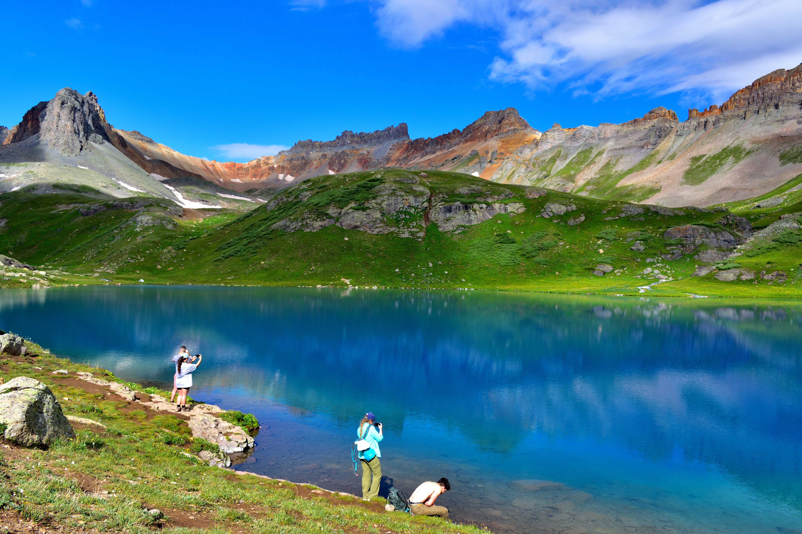
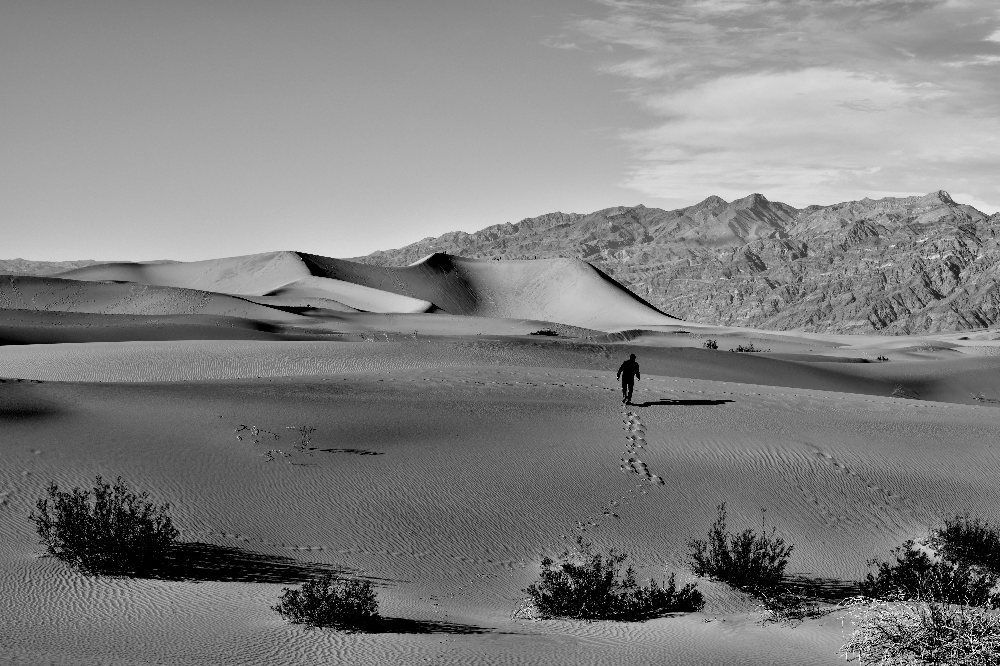
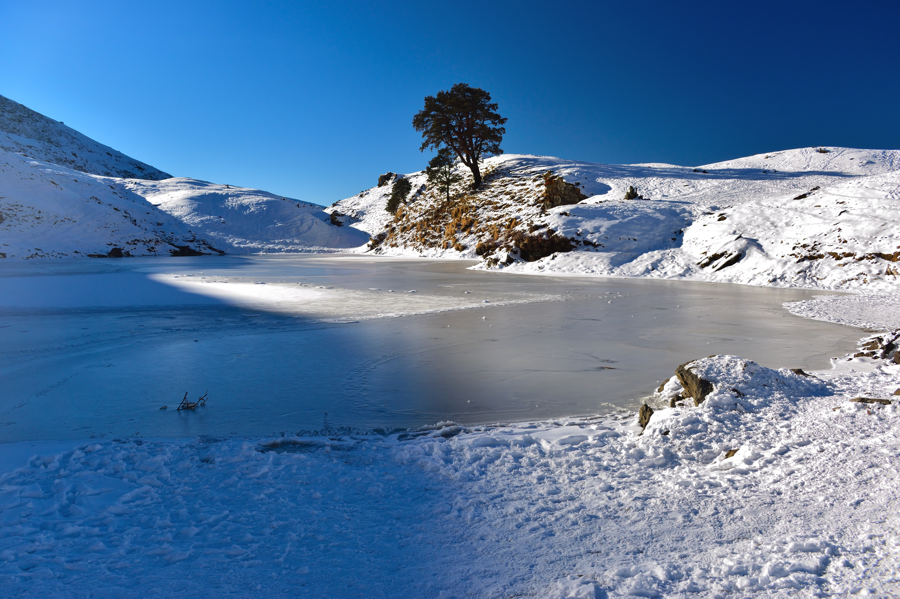
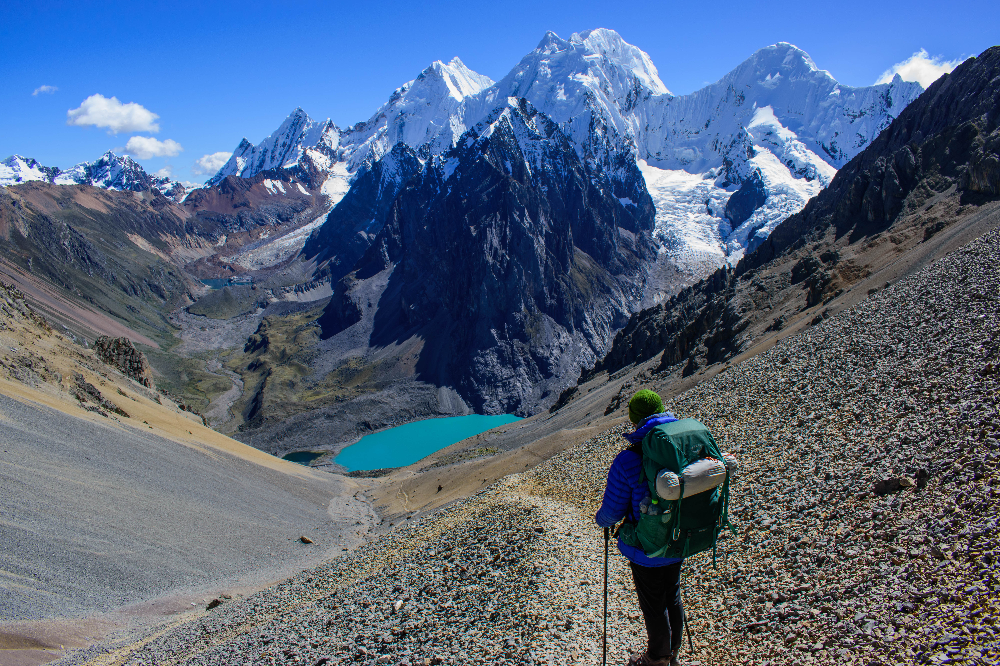

Outside research, I enjoy several extra curricular activities, including hiking, music composition. While many of these activities are recreational in nature, they help me keep motivated and evolve myself.

### Hiking

I particularly enjoy high-altitude, multi-day treks. Because such trips require early planning, finding fellow trekkers, and careful assessment of risks, they have shaped how I approach planning in research as well. They have also taught me persistence when the path forward is difficult.

::: {layout-ncol=2}

:::

### Music

I have a keen interest in various kinds of instrumental music. As a guitar enthusiast with basic instrument experience, I have tried to explore possibilities of composing small pieces of music.

[Attached](files/composition.mp3) is a copy of small music that I composed a while ago. It layers two guitar tracks that I recorded myself, with a few effects added in Cubase, a digital audio workstation.